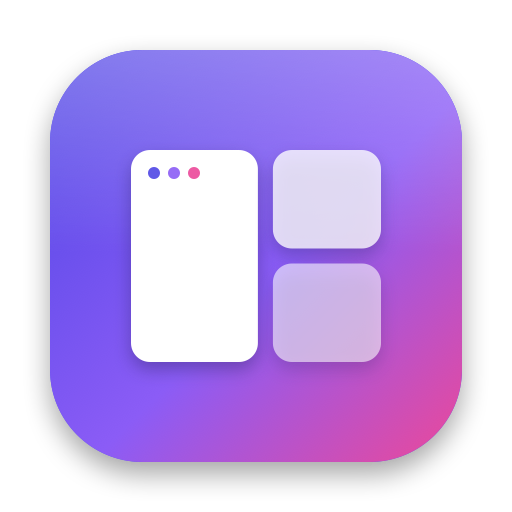
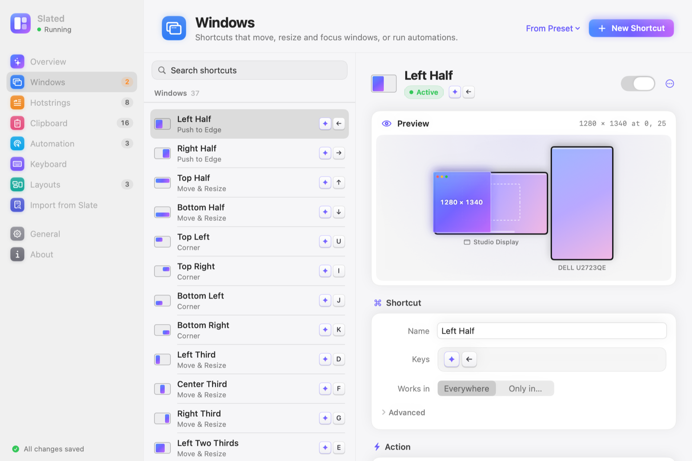
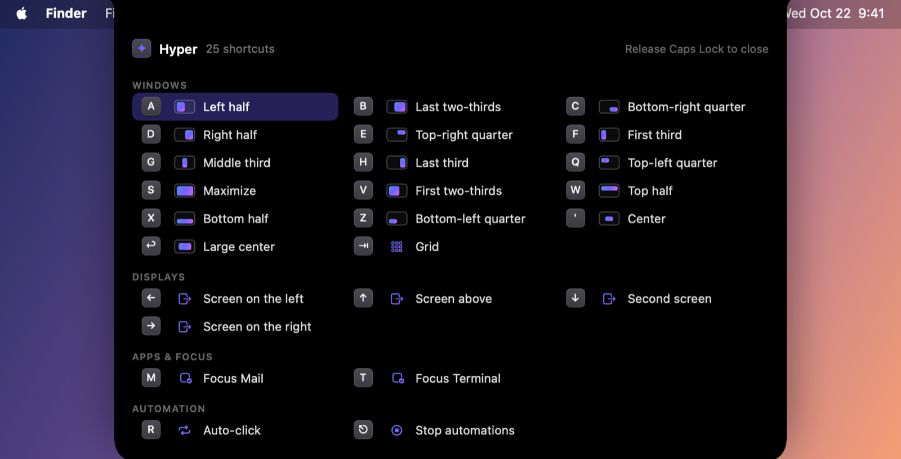
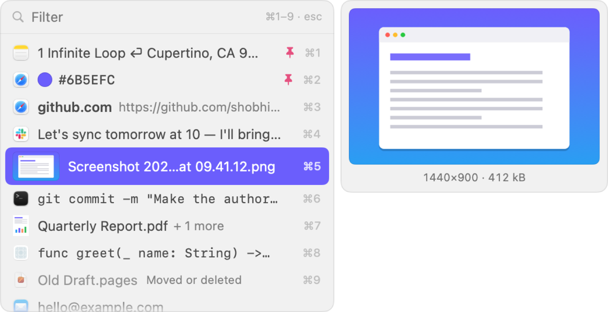

<p align="center"></p>

<h1 align="center">Slated</h1>

<p align="center"><b>Keyboard-first window management, a Hyper key, text expansion, clipboard history and game automation for macOS and GNOME, in one app.</b></p>

Slated is a modern successor to [Slate](https://github.com/jigish/slate), the endlessly configurable
window manager that has been unmaintained since 2013. It keeps everything that made Slate great,
imports your existing `~/.slate` or `~/.slate.js` into its own config, and adds what Slate users
usually install other tools for:

- **Window management:** every Slate operation is supported:
  - move, resize, push, nudge, throw and corner;
  - chain, sequence, layouts, and layouts applied automatically when your displays change;
  - snapshots, undo, directional focus, window hints and the grid.
- **A Hyper key** (from Karabiner-Elements): Caps Lock becomes ⌃⌥⇧⌘ while held. No kernel or driver
  extension needed.
- **Hotstrings** (from Keyboard Maestro): type `;shrug` and get `¯\_(ツ)_/¯`. Placeholders like
  `{date}` and `{clipboard}`, per-app filters, and a choice of typing or pasting.
- **Clipboard history** (like Keyboard Maestro's): text, images, copied files and screenshots saved
  as files. ⇧⌘V opens a small picker right at the text caret; type to filter, ↩ or ⌘1–9 pastes into
  the app you were in. Pin, delete and browse in Settings. Passwords that apps mark as secret are
  skipped.
- **Game automation** (like AutoHotkey, without a scripting language): auto-click, hold a mouse
  button or key, repeat while held or a set number of times, short macros with waits. A stop
  shortcut and automatic stops (switching apps, sleep, a time limit) make sure nothing stays held.
- **A notch island:** running automations (hover to stop them), a cheat sheet of your Hyper shortcuts
  while you hold Caps Lock, the active modal key, and a word on what each shortcut did. On displays
  without a notch it hangs from the top center.
- **One window for all of it**, with live previews of where a window will land. Slated stays in the
  Dock: close the window and it keeps working; click its Dock icon (or its menu bar icon) to come back.

<p align="center">
  <picture>
    <source media="(prefers-color-scheme: dark)" srcset="docs/images/settings-windows-dark.png">
    
  </picture>
</p>
<p align="center">
  
</p>
<p align="center">
  <picture>
    <source media="(prefers-color-scheme: dark)" srcset="docs/images/clipboard-picker-dark.png">
    
  </picture>
</p>

> **Status:** early development, used daily by its author. macOS 14+ (Apple Silicon first) and GNOME
> 46–51. Free and open source: there are no prebuilt releases yet, so build from source: one
> command on either system, below.

## Install

Clone the repository, then run one command. It's safe to run again any time, after a `git pull` or
a change.

### macOS 14+

Needs the Xcode Command Line Tools (`xcode-select --install`).

```sh
git clone https://github.com/shobhitg/slated
cd slated
./install.sh
```

It builds Slated, installs `~/Applications/Slated.app`, launches it, and checks its log to confirm
the new build is running. Each run quits the running copy cleanly first, so Caps Lock is restored.

Slated opens on **Get Started**. When macOS asks, switch Slated on in **System Settings → Privacy &
Security → Accessibility**, and its window comes back to the front, ready for the next step.

The first run asks for your login password once, to create a local signing certificate. Every build
is signed with it, so you grant Accessibility once, not after every reinstall. The certificate lives
only in your keychain; no Apple developer account is needed.

| | |
|---|---|
| `./install.sh --check` | Run the test suite first; install only if it passes |
| `./install.sh --debug` | Debug build, which compiles faster (`make run`) |
| `./install.sh --uninstall` | Remove the app, keeping config and logs (`--purge` removes those too) |

**Coming from Slate or Karabiner-Elements?**
- Quit Slate first: both apps want the same shortcuts.
- On first launch Slated imports your `~/.slate.js` (or `~/.slate`) into its own config, and says
  which shortcuts it couldn't convert. It doesn't read the file after that; **File → Import Slate
  Config into Slated…** imports it again, adding only what's new.
- If Karabiner-Elements turns Caps Lock into Hyper, either keep using it (Slated's bindings work
  with any Hyper key) or turn that rule off and enable Slated's own Hyper key.

### Linux (GNOME 46–51)

Ubuntu 24.04+, Fedora 40+, Debian 13, Arch or openSUSE, on Wayland or Xorg.

```sh
git clone https://github.com/shobhitg/slated
cd slated
linux/install.sh
```

Slated runs on GNOME as a GNOME Shell extension, with the same `config.json` and `settings.json` as
on the Mac. The installer:
- **Checks first** for GNOME 46–51, and finds your session (X11 or Wayland) and package manager
  (apt, dnf, pacman or zypper). On another desktop or GNOME version it stops before changing
  anything and says what it found.
- **Installs and enables** Slated's GNOME Shell extension (turning on GNOME's Extensions switch if
  it's off, after asking), and puts Slated in your apps.
- **Installs keyd** from your distribution's packages, or builds a pinned release from source where
  there's no package (Ubuntu 24.04, Fedora). It makes Caps Lock the Hyper key, as on the Mac.
- **Installs espanso** for hotstrings: a pinned release checked against its checksum, for your
  session (X11 or Wayland). Where espanso has no package (Fedora on Wayland), it says so and carries
  on.
- **Ends with a summary** and the one step left: logging out (it offers to do it), or on Xorg,
  restarting GNOME Shell with Alt+F2 `r`.

sudo asks for your password once, to install keyd and espanso.

After you log back in, Slated opens on Get Started. Later, find Slated in your apps or click its icon
in the top bar.

| | |
|---|---|
| `linux/install.sh --yes` | Ask nothing (for scripts) |
| `linux/install.sh --no-keyd`, `--no-espanso` | Leave keyd or espanso out |
| `linux/install.sh --verify` | Check that GNOME runs Slated, and say what to fix if it doesn't |
| `linux/install.sh --uninstall` | Remove the extension and its app entry, keeping config and logs (`--purge` removes those too) |

[docs/LINUX.md](docs/LINUX.md) covers the Hyper key and hotstrings on GNOME, how Slated differs from
the Mac, and troubleshooting.

## Logs

Slated records every interaction and its outcome in `~/Library/Logs/Slated/slated.log` (on Linux,
`~/.local/state/slated/slated.log`), one JSON event per line: hotkeys, Hyper combos, hotstring expansions, menu and settings changes, errors,
permission changes and crashes.

```sh
make logs                              # follow live
scripts/logs.py --session last         # everything since the last launch
scripts/logs.py --errors --since 1h    # problems in the last hour
make log-summary                       # counts, app starts, recent errors
```

`scripts/logs.py` reads either. On the Mac the same events also appear in Console.app under the
subsystem `io.github.shobhitg.slated`.

## Configuration

- **Slated's window:** use it for everyday changes (click Slated in the Dock, or press ⌘, in Slated).
- **`~/.config/slated/config.json`:** what your keys do: shortcuts, hotstrings, the Hyper key,
  layouts. Edit it by hand if you prefer; Slated reloads it on save.
- **`~/.config/slated/settings.json`:** how Slated behaves: general, window, clipboard, automation
  and island settings.
- **Slate files:** `~/.slate.js` and `~/.slate` are imported into `config.json`, not run.

See [docs/CONFIG.md](docs/CONFIG.md) for the format, every action, and hotstring options.

```jsonc
{
  "version": 2,
  "keyboard": { "capsLock": "hyper" },
  "bindings": [
    { "name": "Left half", "keys": "hyper+a", "action": "push left bar-resize:screenSizeX/2" },
    { "keys": "hyper+right", "action": "throw right resize" }
  ],
  "hotstrings": [ { "trigger": ";today", "replacement": "{date:yyyy-MM-dd}" } ]
}
```

## Privacy

Hotstrings and the Hyper key work by watching keystrokes system-wide.
- The log contains shortcut names, hotstring triggers, app names and error messages.
- It never contains typed text, hotstring replacements or window titles, and it stays on your Mac.
- Slated keeps only the last few characters in memory to match triggers.
- It never logs, stores or sends what you type.
- Like every such tool, it can't see keystrokes while macOS Secure Input is on (password fields).
- Clipboard history stays on your Mac in a file only you can read
  (`~/Library/Application Support/Slated/clipboard.json`). It skips what password managers and
  browsers mark as secret, and the log notes only what kind of copy it was and how big, never its
  text, image or file names.

## Development

| Command | What it does |
|---|---|
| `make run` | Debug build, installed and relaunched (`./install.sh --debug`) |
| `make check` | Run every automated test: unit, contract and end-to-end smoke tests (see [docs/TESTING.md](docs/TESTING.md)) |
| `make test` | Unit and contract tests only (`FILTER=name` to narrow) |
| `make logs` | Follow Slated's event log |
| `make install` | Same as `./install.sh` |
| `make test-install` | Installer test in a throwaway folder (launches the app briefly) |
| `make fmt` / `make lint` | Format / check with `swift format` |
| `make reset-permissions` | Make macOS forget Slated's Accessibility permission |

The code is a Swift package with no Xcode project:

| Module | Contents |
|---|---|
| `SlatedCore` | Pure logic: model, Slate syntax, expressions, window math, hotstring matching |
| `SlatedSystem` | macOS integration: Accessibility, hotkeys, event tap, Hyper key, text injection, the config files |
| `SlatedScript` | Slate's JavaScript API on JavaScriptCore, to import `~/.slate.js` |
| `SlatedUI` | SwiftUI: the main window (Get Started and the settings pages), the clipboard picker and the island |
| `Slated` | The app (Dock icon, main window, menu bar icon) that wires it all together |

## Roadmap

- [ ] Prebuilt downloads. They won't be notarized (that needs a paid Apple account), so macOS asks
      you to allow the first launch in System Settings → Privacy & Security.
- [ ] Automatic updates (Sparkle 2)
- [ ] A `slated` command-line tool
- [ ] Importer for Keyboard Maestro hotstrings

Slated won't be on the Mac App Store: its sandbox rules out the Hyper key and hotstrings.

## Contributing

Issues and pull requests are welcome.
- Run `make check` before sending a change: it runs every automated test, Mac and Linux.
- Behavior only a real Mac or GNOME session can show goes on the manual checklist in
  [docs/TESTING.md](docs/TESTING.md).
- [CLAUDE.md](CLAUDE.md) has the conventions: coordinates, logging, privacy rules and the design
  decisions so far.
- Slate is GPLv3, so please don't copy its code: Slated reimplements its behavior from the
  documentation.

## Credits & license

Inspired by [Slate](https://github.com/jigish/slate) by Jigish Patel. Slated is an independent
reimplementation that contains no code from Slate (GPLv3). MIT licensed; see [LICENSE](LICENSE).
